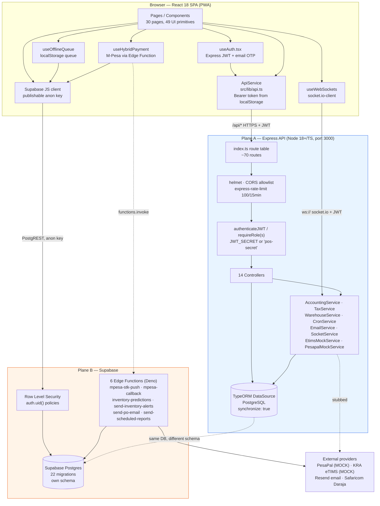
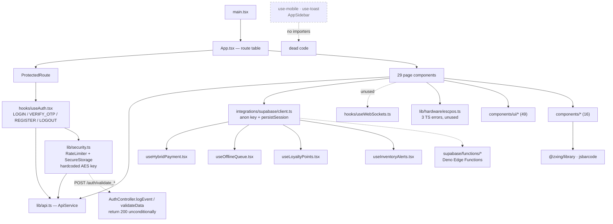
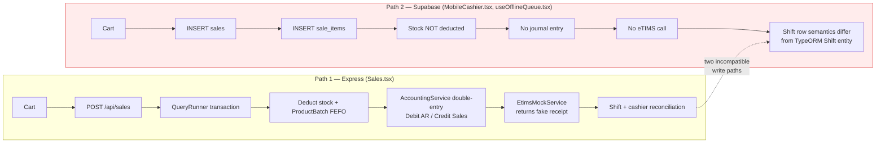

# AUDIT_REPORT.md (ARCHIVED & OUTDATED)

> [!WARNING]
> **HISTORICAL ARCHIVE NOTICE**
> This audit report was produced on 2026-09-30 during the initial prototype phase. It is **OUTDATED** and retained strictly for historical reference.
> All major security findings, architectural gaps, and workflow defects identified herein were resolved during the production-hardening program (Phases 0 through 7). For current system status, see `docs/PRODUCTION_READINESS.md`.

**Repository:** `Retail-store-pos-system-main` (retail/POS + inventory + procurement + accounting)
**Audit type:** Read-only, static, evidence-based source review (Historical)
**Date:** 2026-09-30
**Branch / HEAD:** `main` @ `daab68a` ("appended all the missing migrations")
**Auditor scope:** Whole repository, Phases 1–5
**Repository changes made by this audit:** none. This report is the only file created.

---

## 0. How to read this report

- Every claim carries a `file:line` citation or is marked `UNVERIFIED`.
- Status vocabulary: `Complete`, `Partial`, `Stubbed/Placeholder`, `Broken`, `Missing`.
- Severity: **S1 Critical** (data loss, unauthenticated privilege or PII exposure, money movement) · **S2 High** · **S3 Medium** · **S4 Low**.
- Effort: `S` (hours) · `M` (1–3 days) · `L` (1–3 weeks).
- `UNVERIFIED` means the claim could not be confirmed from the repository alone (needs a running environment, live Supabase project, or external provider).
- **No secret values are reproduced anywhere in this report.** Environment files are cited by name and key only.

---

## PHASE 1 — Executive Summary

### 1.1 What this system is

A retail point-of-sale platform for a Kenyan multi-branch retailer, targeting KRA eTIMS tax compliance and M-Pesa payments. It is a React + TypeScript + Vite PWA (`package.json:6-12`, `vite.config.ts:57-100`) talking to two independent backends **at the same time**:

| Plane | Stack | Auth | Location |
|---|---|---|---|
| **Plane A — Express API** | Express 5 + TypeORM + PostgreSQL + Socket.IO | Custom JWT + email OTP | `server/` |
| **Plane B — Supabase** | Supabase Postgres + RLS + 6 Edge Functions (Deno) | Supabase session JWT (never established) | `supabase/`, called from 19 `src/` files |

Both planes point at *the same logical database domain* but with **different schemas, different column names, and different table shapes** (§4.4). This is the defining architectural fact of the codebase and the root cause of most findings below.

### 1.2 Headline verdict

| Dimension | Score (0–10) | Rationale |
|---|---|---|
| Security | **2** | Unauthenticated admin self-registration, two hardcoded JWT fallbacks, RLS policies that allow `anon`, unauthenticated payment webhook that marks sales paid, a client-side "security" library that posts to handlers which return `{valid: true}` unconditionally. |
| Data integrity | **2** | `synchronize: true` on every boot, a second write path that bypasses the server transaction, offline queue inserting raw rows, and two divergent schemas. |
| Test coverage | **0** | Zero test files. `server/package.json:7` is `echo "Error: no test specified" && exit 1`. No CI, no Docker, no coverage config. The three "test"-named files at the repo root are static-analysis artifacts, not tests. |
| Build / CI health | **3** | Backend typechecks clean. Frontend has **9 TypeScript errors** and **418 ESLint errors**. `npm run build` does not typecheck, so these ship silently. No CI pipeline exists. |
| Feature completeness vs. `README.md` | **3** | eTIMS and PesaPal are explicit mocks. Mobile checkout bypasses the accounting engine. ~19 files of UI are gated behind RLS that the app's own auth model can never satisfy. |
| Maintainability | **3** | 34 TypeORM entities vs. a separate Supabase migration history; orphaned controllers, dead hooks, and a stale duplicate tree under `.kilo/worktrees/healthy-banana`. |
| Documentation accuracy | **2** | `README.md` and `FEATURES.md` assert production readiness, zero-trust security, and working M-Pesa/eTIMS. None of that is true of the code as committed. |
| **Overall maturity** | **2.5 / 10 — "Functional prototype with production-blocking defects"** | The Express plane is genuinely thoughtful (real transactions, real double-entry accounting, real OTP flow). It is undermined by auth, RLS, and data-plane defects severe enough that the system should not be exposed to real customers or real money as it stands. |

### 1.3 The five things that must be fixed before any real deployment

1. **Anyone can create themselves an admin account** — `AuthController.register` trusts a client-supplied `role` on an unauthenticated route (`server/src/index.ts:65`, `server/src/controllers/AuthController.ts:16,30`).
2. **Supabase RLS exposes PII and settings to the anonymous internet** — `USING (true)` policies on `customers`, `vendors`, `settings` and `WITH CHECK (true)` on `stock_movements` (`supabase/migrations/20251007055111…:16,42,160`, `20251227113728…:203`).
3. **An unauthenticated webhook can mark any sale paid and post accounting entries** — no PesaPal signature check (`server/src/index.ts:152`, `server/src/controllers/PaymentController.ts:7-35`).
4. **The mobile checkout and offline queue write to the database without the server**, so no transaction, no stock deduction, no journal entry, no shift reconciliation (`src/pages/MobileCashier.tsx:144`, `src/hooks/useOfflineQueue.tsx:51-57`).
5. **There is no way to test any of this** — zero tests, zero CI, and a frontend that does not typecheck.

---

## PHASE 2 — Architecture

### 2.1 Directory inventory and purpose

| Path | Purpose | Assessment |
|---|---|---|
| `src/` | Frontend React SPA | 112 `.ts`/`.tsx` files, ~18.6k lines. Real application code. |
| `src/components/ui/` | 49 shadcn/ui primitives | Unmodified vendored primitives. Acceptable. |
| `src/components/` | 16 domain components | Mixed quality; several are unreferenced (§5.4). |
| `src/pages/` | 30 route components | 29 routed (`src/App.tsx:63-99`), 1 orphan (`Index.tsx`). Mixed data planes. |
| `src/hooks/` | 8 hooks | `useAuth` (Express), `useHybridPayment`/`useOfflineQueue`/`useLoyaltyPoints`/`useInventoryAlerts` (Supabase), `useWebSockets` (Socket.IO), 3 unused. |
| `src/lib/` | 4 files | `api.ts` (HTTP client), `security.ts` (largely inert), `utils.ts`, `hardware/escpos.ts` (does not compile). |
| `src/integrations/supabase/` | Supabase client + generated types | Publishable (anon) key by design. |
| `server/` | Express API | 62 `.ts` files, ~4.3k lines, plus its own `package.json`/`tsconfig.json`/`.env`. |
| `server/src/controllers/` | 14 controllers | 3 methods are never routed (§4.2). |
| `server/src/services/` | 9 services | 2 are explicit mocks, 1 is dead code, 1 logs OTP plaintext. |
| `server/src/entity/` | 34 TypeORM entities | Rich model: double-entry ledger, batches, warehouses, bins, aisles, credit notes. |
| `server/src/migration/` | 1 TypeORM migration file | `1775884690154-AddInventoryEntities.ts` — contradicts the "migrations for prod" comment at `data-source.ts:16`. |
| `supabase/migrations/` | 22 SQL migrations | Independent schema, ~82 `CREATE POLICY` statements, 97 `auth.uid()` references, RPCs and security functions. |
| `supabase/functions/` | 6 Deno Edge Functions | M-Pesa STK push + callback, inventory prediction, alerts, PO email, scheduled reports. |
| `public/` + `dist/` | Static PWA assets / build output | `dist/` is committed and stale. |
| `.kilo/worktrees/healthy-banana/` | Duplicate working tree | 100% content copy of the repo. Lint noise, confusion risk. |
| Root scripts | `production_audit.js`, `security_test.js`, `categorize_lint.{js,cjs}`, `migration_helper.js`, `*.json` reports | Ad-hoc one-shot analysis output committed to the repo. Not tests. |
| `database_migrations.sql` | Standalone SQL | Third schema definition, unconnected to both TypeORM and `supabase/migrations/`. |

### 2.2 High-level architecture (dual data plane)



**The dashed link between the two databases is the core defect.** Both planes are assumed to read and write the same business data. They are not the same schema, and neither plane is aware of the other's writes.

### 2.3 Module dependency map (frontend)



Two dependency problems are visible here:

- `lib/security.ts` depends on backend endpoints that do nothing (§4.6). The dependency is real; the security is not.
- The Supabase client is imported by 19 files but the app never calls `supabase.auth.*` except one password-reset call (`src/pages/Users.tsx:211`), so no Supabase session ever exists.

### 2.4 Authentication flows as actually implemented

```mermaid
sequenceDiagram
    autonumber
    participant U as Browser
    participant E as Express /auth
    participant D as PostgreSQL (TypeORM)
    participant R as Resend / console

    U->>E: POST /api/auth/login {email, password}
    E->>D: bcrypt.compare
    E->>D: mark prior OTPs used; insert OtpCode (bcrypt-hashed, 10 min TTL)
    E->>R: sendOtpEmail(email, rawOtp)
    Note over R: EmailService falls back to console.log when RESEND_API_KEY absent
    E-->>U: { requires_otp: true, otp_token } (JWT, is_otp_phase, 10m)

    U->>E: POST /api/auth/verify-otp {otp_token, code}
    E->>D: bcrypt.compare(code)
    E->>D: mark OTP used
    E-->>U: { token, user } (JWT with id/email/role, 1d)

    U->>U: localStorage.setItem("jwt_token", token)
    Note over U: Plaintext. No refresh, no revocation, no rotation.
    U->>E: any request + "Authorization: Bearer <jwt>"
    E->>E: jwt.verify(token, JWT_SECRET || "pos-secret")

    rect rgba(200,0,0,0.06)
    Note over U,D: Meanwhile, on the Supabase plane
    U--xR: supabase.from("products").select() — no Supabase session exists
    Note over R: RLS policy requires auth.uid() → 0 rows / permission denied
    end
```

### 2.5 Sales / checkout paths



### 2.6 Data model — the two schemas are not the same

```mermaid
erDiagram
    direction TB

    subgraph TO["TypeORM / Express schema (server/src/entity/*) — 34 entities"]
        T_USERS["users<br/>id · email · password_hash<br/>role · is_active · profile"]
        T_PROFILE["profiles<br/>user_id · full_name"]
        T_SALES["sales<br/>id · shift_id · customer_id<br/>subtotal · total_amount<br/>mpesa_amount · pesapal_tracking_id<br/>pesapal_status · status"]
        T_SALEITEMS["sale_items<br/>sale_id · product_id · quantity<br/>unit_price · tax_amount"]
        T_BATCHES["product_batches<br/>product_id · batch_no · expiry_date"]
        T_SHIFT["shifts<br/>cashier_id · opened_at · closed_at<br/>opening_float · closing_cash"]
        T_LEDGER["journal_entries → journal_lines<br/>reference_type · reference_id<br/>double-entry postings"]
        T_WH["warehouses → warehouse_stock<br/>aisles → bins"]
    end

    subgraph SB["Supabase schema (supabase/migrations/*) — separate history"]
        S_PROFILES["profiles<br/>id (= auth.users id)<br/>full_name · role"]
        S_ROLES["user_roles<br/>user_id · role"]
        S_SHIFTS["shifts<br/>shift_id · cashier_id · terminal_id<br/>opened_at · closed_at · status"]
        S_SALES["sales<br/>id · shift_id · customer_id<br/>subtotal · tax_amount · total_amount<br/>payment_method · status"]
        S_MPESA["mpesa_transactions<br/>checkout_request_id · phone_number<br/>receipt · status"]
        S_STOCKMOVE["stock_movements<br/>product_id · type · quantity · user_id"]
        S_TAXES["tax_classes · settings · audit_logs<br/>sync_queue · idempotency_keys"]
    end

    T_USERS ||--|| T_PROFILE : "user_id FK"
    T_USERS ||--o{ T_SALES : "sales.user_id"
    T_SALES ||--|{ T_SALEITEMS : "sale_items.sale_id"
    T_SALEITEMS }o--|| T_BATCHES : "batch_id"
    T_SALES }o--|| T_SHIFT : "shift_id"
    T_SALES ||--|| T_LEDGER : "reference_id + reference_type"
    T_LEDGER ||--|{ T_LEDGER : "journal_lines"
    T_WH }o--|| T_BATCHES : "warehouse_stock"

    S_PROFILES ||--o{ S_ROLES : "user_id"
    S_PROFILES ||--o{ S_SHIFTS : "cashier_id"
    S_SHIFTS ||--o{ S_SALES : "shift_id"
    S_SALES ||--|{ S_SALES : "sale_items"
    S_SALES ||--o{ S_MPESA : "checkout_request_id"
    S_SALES ||--o{ S_STOCKMOVE : ""

    T_PROFILE -.->|"id = users.id<br/>≠ auth.users.id"| S_PROFILES
    T_SALES -.->|"no pesapal_*,<br/>no mpesa_transactions"| S_SALES
    T_SHIFT -.->|"cashier_id→users.id,<br/>no shift_id/terminal_id/status"| S_SHIFTS

    style TO fill:#eef6ff,stroke:#2563eb
    style SB fill:#fff5ee,stroke:#ea580c
```

Key structural mismatches (each independently confirmed):

| Concept | TypeORM | Supabase | Consequence |
|---|---|---|---|
| User identity | `users.id` (own sequence) with `profiles.user_id` FK | `profiles.id` must equal `auth.users.id` | A `Profile` written by Express has an id that is meaningless to Supabase RLS. |
| Role | `users.role` enum, single role | `user_roles` table, many-to-many | Two role stores; no sync. `Users.tsx` edits only the Supabase one, so **role changes in the UI do not affect Express authorization**. |
| Sale | `pesapal_tracking_id`, `pesapal_status`, `mpesa_amount`, `sale_item_batches` | `payment_method`, separate `mpesa_transactions` | `PaymentController` writes columns that only exist in Plane A. |
| Shift | `cashier_id` → `users.id`, `opened_at`/`closed_at`, opening/closing float | `shift_id`, `cashier_id`, `terminal_id`, `status` | `MobileCashier.tsx:41` writes the Supabase shape; `ShiftController` reads the TypeORM shape. Closing a shift in the UI does not close the server's shift. |
| Stock movement | `ProductBatch`, `WarehouseStock` | `stock_movements` (append-only, `WITH CHECK (true)`) | Two independent stock ledgers. |

---

## PHASE 3 — Code Quality

### 3.1 Measured build/lint/type health

| Check | Command | Result |
|---|---|---|
| Frontend typecheck | `npx tsc -p tsconfig.app.json --noEmit` | **FAIL — 9 errors** |
| Backend typecheck | `npx tsc --noEmit` (in `server/`) | **PASS — 0 errors** |
| Frontend lint | `npx eslint .` | **FAIL — 464 problems (418 errors, 46 warnings)** |
| Frontend build | `npm run build` → `vite build` | Not run — would overwrite committed `dist/`. `UNVERIFIED`. |
| Tests | `npm test` | **No test script in `package.json`.** `server` test script is `echo "Error: no test specified" && exit 1` (`server/package.json:7`). |
| CI | — | **Missing.** No `.github/`, no CI config of any kind. |
| Containers | — | **Missing.** No `Dockerfile`, no `docker-compose.yml`. |
| Deploy config | — | **Missing.** No `vercel.json`, `netlify.toml`, or IaC. |

Lint breakdown (by area):

| Area | Files linted | Errors | Warnings |
|---|---|---|---|
| `src/` | 348 | 406 | 46 |
| `supabase/functions/` | 12 | 12 | 0 |
| root scripts/config | 10 | 0 | 0 |
| `.kilo/worktrees/` | 10 | 0 | 0 |

### 3.2 The 9 frontend type errors (all shipped, none fatal to the bundle)

`package.json:8` defines `build` as `vite build` with **no `tsc` step**, so `npm run build` emits a bundle while these errors sit in the source.

| Location | Error |
|---|---|
| `src/lib/hardware/escpos.ts:2` | `TS2304: Cannot find name 'SerialPort'` |
| `src/lib/hardware/escpos.ts:12` | `TS2339: Property 'requestPort' does not exist on type 'unknown'` |
| `src/lib/hardware/escpos.ts:27` | `TS2339: Property 'getPorts' does not exist on type 'unknown'` |
| `src/pages/NewProduct.tsx:130` | `TS2339: Property 'parent' does not exist on type 'unknown'` |
| `src/pages/ReceivePurchaseOrder.tsx:144` | `TS2339: Property 'grn' does not exist on type 'unknown'` |
| `src/pages/Returns.tsx:111` | `TS2339: Property 'status' does not exist on type 'Sale'` |
| `src/pages/Returns.tsx:466` | `TS2367: comparison '"cashier"' vs '"supervisor"' has no overlap` |
| `src/pages/Returns.tsx:466` | `TS2367: comparison '"cashier"' vs '"manager"' has no overlap` |
| `src/pages/Sales.tsx:663` | `TS2322: Promise<void>` not assignable to `void \| Promise<boolean>` |

Two are real behavioural bugs, not just typing noise:

- **`src/pages/Returns.tsx:466`** — the compiler proves the branch is unreachable. An admin/supervisor sees no approve/reject buttons, or a cashier does, depending on how the guard was written. Approval workflow is unreachable in at least one role.
- **`src/pages/Sales.tsx:663`** — the barcode-scan payment callback returns `void` where a `boolean` is required, so the payment-due check cannot be trusted for a scanned item.

### 3.3 The lint wall

418 errors, dominated by `@typescript-eslint/no-explicit-any` and unsafe `any` usage in service/controller code. At the current error density (≈1.2 errors per source file across `src/`), the linter is not functioning as a gate — it is noise, and any team will disable it. This is a **process** defect, not a style complaint: the number is the finding.

### 3.4 `lib/security.ts` is a security theatre module

`src/lib/security.ts` presents as a security control and is wired into nothing that enforces anything.

| Claim implied by the module | Reality |
|---|---|
| Client-side rate limiting (`apiRateLimiter` 30/min, `paymentRateLimiter` 5/5min, lines 45-46) | In-memory `Map` in the browser tab (line 11). Bypassed by reload, new tab, or a direct request. Real limiting does exist server-side, but at one global setting: `max: 100` per IP per 15 min for all of `/api/` (`server/src/index.ts:51-56`). The payment limiter is never applied to any payment route. |
| "Secure" encrypted storage (`SecureStorage`, lines 102-160) | AES key is **hardcoded in shipped client source**: `private encryptionKey = 'pos_secure_key_12345678901234567'` (line 102). Any browser can read the key. Provides obfuscation, not confidentiality. |
| Server-side input validation (`POST /auth/validate_input_data`, line 86) | `AuthController.validateData` returns `res.status(200).json({ valid: true })` — **unconditionally true** (`server/src/controllers/AuthController.ts:200-203`). Validation always "passes". |
| Security / error / PWA event logging (lines 227, 249, 313) | `AuthController.logEvent` returns `{ status: "logged" }` and **persists nothing** (`AuthController.ts:195-198`). Three of these endpoints are also unauthenticated (`server/src/index.ts:71-73`). Nothing is ever logged. |
| Session protection | The actual credential is stored as plaintext `localStorage["jwt_token"]` (`src/lib/api.ts:5`), read by any script on the page and by any XSS. `SecureStorage` is not used for it. |

**Verdict: Stubbed/Placeholder, presented as Complete.** The presence of this module is worse than its absence, because it creates a false sense of coverage.

### 3.5 Error handling and observability

- Server error handler returns a bare `{ error: "Internal Server Error" }` and logs `err.stack` to stdout (`server/src/index.ts:165-168`). No request ID, no error reporting service, despite `supabase/migrations/20260101110500_error_monitoring.sql` and `VITE_ERROR_REPORTING_ENABLED` existing.
- Client `ApiService.request` reads `errorData.message` but the server's 404/500 handlers return `error`, not `message` (`src/lib/api.ts:21` vs `server/src/index.ts:161,167`). **Every server-generated error surfaces to the user as the generic string "API Request Failed".**
- No `AbortController`/timeout on any fetch. A hung backend hangs the UI indefinitely.

### 3.6 Duplication and dead code

- `.kilo/worktrees/healthy-banana/` is a full duplicate of the tree (identical `package.json`, `supabase/migrations/`, all 30 pages). It contributes 10 linted files and doubles grep/search results. Nothing in the app imports from it.
- Two adjacent `categorize_lint.js` and `categorize_lint.cjs` (`categorize_lint.cjs:1`, `categorize_lint.js:1`) — same purpose, duplicated.
- `database_migrations.sql` at the repo root is a **third** schema definition, unrelated to `supabase/migrations/` and to TypeORM.
- One-shot analysis outputs committed as source of truth: `production_security_audit.json`, `security_test_report.json`, `lint.json`. These are stale the moment code changes and invite false confidence.
- `src/pages/Index.tsx` is not routed (`src/App.tsx:63-99`).
- Confirmed with no importers: `src/components/AppSidebar.tsx`, `src/hooks/use-mobile.tsx`, `src/hooks/use-toast.ts`, `src/hooks/useOfflineQueue.tsx` (imported only by nothing; `src/pages/MobileCashier.tsx` writes directly), `server/src/services/PesapalMockService.ts`.
- `src/lib/hardware/escpos.ts` is the only receipt-printer path and it does not compile.

---

## PHASE 4 — Security

### S1 — Critical

#### 4.1 Unauthenticated self-registration as any role, including admin
`server/src/index.ts:65` registers `POST /api/auth/register` with **no** `authenticateJWT`. `AuthController.register` destructures `role` straight from the request body and writes it (`AuthController.ts:16`, `AuthController.ts:30`):

```
const { email, password, full_name, role } = req.body;   // :16
user.role = role || AppRole.CASHIER;                      // :30
```

Any anonymous caller can `POST {"email":"x@y.z","password":"...","role":"admin"}` and receive an account whose JWT grants `requireRole("admin")` on ~20 routes. `useAuth.tsx:95` only sends `email/password/full_name`, so the UI is unaffected — the hole is reachable only by direct API call, which is precisely what makes it a realistic attack.

**Fix:** drop `role` from the register contract; force `AppRole.CASHIER`; require an authenticated admin or an invite token to create any other role; add an integration test that asserts a register response cannot produce an admin JWT.

#### 4.2 Supabase RLS grants anonymous read of PII and settings
RLS **is** enabled on the affected tables, and the policies attached to them have no `TO` role restriction and no `auth.uid()` predicate, so they apply to the `anon` role that the browser's publishable key assumes:

| Policy | Table | Effect | Location |
|---|---|---|---|
| `"Anyone can view customers" … FOR SELECT USING (true)` | `public.customers` | **Any unauthenticated client reads all customers** (names, phones, email, addresses, loyalty balances) | `supabase/migrations/20251007055111_…sql:16` (RLS enabled at `:14`) |
| `"Anyone can view vendors" … USING (true)` | `public.vendors` | Unauthenticated read of supplier records | `…107736c7…sql:42` (RLS at `:40`) |
| `"Anyone can view settings" … USING (true)` | `public.settings` | Unauthenticated read of store configuration | `…107736c7…sql:160` (RLS at `:158`) |
| `"System can create stock movements" … WITH CHECK (true)` | `public.stock_movements` | **Any unauthenticated client writes inventory movements**, corrupting the stock ledger | `20251227113728_…sql:203` (RLS at `:193`) |

A later migration narrows the SELECT side of `customers`/`vendors` for some roles (`20251009065113_…sql:4,13`), but Postgres ORs permissive policies together — **an added restrictive predicate does not revoke access granted by an existing `USING (true)` policy**. So even the "fix" migrations do not close the exposure. `stock_movements` has no later tightening at all.

*Caveat:* whether these migrations have been applied to the live project is `UNVERIFIED`. If any were skipped, the tables may have RLS disabled entirely, which is worse. Either way the source is unsafe and must not be the basis of a deployment.

**Fix:** drop every `USING (true)` / `WITH CHECK (true)` policy; replace with explicit role predicates; add a policy regression test run against a real Supabase project; add CI that greps migrations for bare `true` predicates.

#### 4.3 Unauthenticated payment webhook marks sales paid and posts accounting entries
`server/src/index.ts:152` mounts `POST /api/webhooks/pesapal/ipn` with no authentication — correct for a webhook, which is why the **absence of a signature check** is the vulnerability. `PaymentController.pesapalWebhook` (`PaymentController.ts:7-35`):

```
// For mock, assume an IPNCHANGE means payment was successful.
sale.pesapal_status = "completed";                    // :28
await queryRunner.manager.save(sale);                 // :33
// then Debit Cash / Credit AR journal entry          // :39-51+
```

No PesaPal IPN signature/IPN secret is validated. An attacker who learns or guesses a `pesapal_tracking_id` can mark any sale paid and cause double-entry postings. Note the handler *does* correctly guard against double-processing (`:23-25`) and *does* use a transaction (`:12-14`) — the design is sound; the authentication of the event is missing.

**Fix:** implement PesaPal IPN validation (their `VALIDATION` service + the `pesapal_ipn_signature` in the callback payload) and reject unverified callbacks. Do not enable real money movement until this is in place.

#### 4.4 A second, unprotected write path to the sales and stock tables
19 `src/` files import the Supabase client directly, and two of them write:

- `src/pages/MobileCashier.tsx:144` — `supabase.from('sale_items').insert(...)` as part of checkout.
- `src/hooks/useOfflineQueue.tsx:51,54,57` — `supabase.from('sales').insert(...)`, `supabase.from('products').insert(...)`, `supabase.from('customers').insert(...)` replayed from a `localStorage` queue (`useOfflineQueue.tsx:19,32,73`).

By design these paths skip: the stock deduction and FEFO batch allocation in `SalesController`, the `AccountingService` double-entry journal, the eTIMS call, and shift reconciliation. The result is a sale that exists in the ledger with **no stock movement and no accounting entry** — books and inventory permanently disagree. The offline queue additionally replays user-authored `localStorage` payloads straight into `products` and `customers`; a user (or any script on the device) can enqueue arbitrary rows.

**Fix:** make the server the only writer. Offline queue should buffer the *intent* and POST to `/api/sales` when connectivity returns, with server-side idempotency keys and conflict resolution.

### S2 — High

#### 4.5 Two hardcoded JWT fallback secrets
| Location | Fallback |
|---|---|
| `server/src/middleware/auth.ts:14` | `process.env.JWT_SECRET \|\| "pos-secret"` |
| `server/src/controllers/AuthController.ts:92`, `:116`, `:163` | `process.env.JWT_SECRET \|\| "pos-secret"` |
| `server/src/services/SocketService.ts:24` | `process.env.JWT_SECRET \|\| "default_secret_key"` |

If `JWT_SECRET` is unset, the deployment silently runs on a publicly known key — anyone can mint a token with `role: "admin"`. The two **different** fallbacks also mean HTTP and WebSocket trust different keys, so a socket can be authenticated by a key the HTTP layer would reject. There is no startup guard asserting the secret is present.

**Fix:** fail fast at boot if `JWT_SECRET` is missing or under 32 bytes; delete all fallbacks; use one secret everywhere (or, better, separate keys for access tokens, OTP tokens, and sockets).

#### 4.6 The "security" endpoints are unauthenticated no-ops
`server/src/index.ts:71-75` mounts five unauthenticated POST endpoints; three are `logEvent` (`:195-198`, returns `{status:"logged"}`, stores nothing) and two are `validateData` (`:200-203`, returns `{valid:true}` always). They exist only to make `src/lib/security.ts` appear to work. They are dead surface area, not controls. See §3.4.

#### 4.7 Auth model cannot satisfy RLS, so ~19 UI modules cannot function
The app authenticates with an Express JWT only. `supabase.auth` is called exactly once in the whole frontend, for a password-reset email (`src/pages/Users.tsx:211`). Therefore no Supabase session exists, and the 82 policies built on `auth.uid()` (97 references) can never match this user.

Concretely denied, per the migration-defined policies (deployment state `UNVERIFIED`):

| Page / component | Supabase calls | Policy gate | Result |
|---|---|---|---|
| `src/pages/Users.tsx:73,86,95,127,135,160,188,191` | `profiles`, `user_roles`, MFA | `Users can view their own profile` / `Admins can view all profiles` (`20251009070435…:8,15`) | Role and user administration UI is non-functional. **And these writes only touch Plane B, so Express `users.role` is never updated** — role changes made in the UI have zero effect on API authorization. |
| `src/pages/MobileCashier.tsx:41,144` | `shifts`, `sale_items` | `Cashiers and admins can create sale items` (`20251007052759…:169`) | Mobile checkout writes fail; §4.4's bypass is theoretical in a correctly-configured deployment and dangerous in a loosened one. |
| `src/pages/Reports.tsx`, `Loyalty.tsx`, `StockMovements.tsx`, `Invoices.tsx`, `SupplierInvoices.tsx`, `DeliveryNotes.tsx`, `VendorPortal.tsx` | various | `Users can view sales` (`20251007052759…:141`) etc. | Empty tables / permission errors. |
| `src/hooks/useLoyaltyPoints.tsx`, `useInventoryAlerts.tsx`, `useHybridPayment.tsx` | loyalty, alerts, M-Pesa | role-gated | Loyalty accrual and hybrid payment UI inert. |

**Fix:** pick one identity authority. Either (a) adopt Supabase Auth end-to-end and make Express verify the Supabase JWT, or (b) keep Express JWT and stop using direct Supabase access from the browser — move every Supabase read/write behind an Express route that maps the JWT to a Supabase service-role call. Option (b) is the smaller change and preserves the current auth UX.

#### 4.8 `synchronize: true` mutates production schema on every boot
`server/src/data-source.ts:16` — `synchronize: true, // Auto-create tables for now; switch to migrations for prod`. TypeORM will **drop and recreate** columns and tables to match entity definitions at every startup. On the Supabase-authored schema, that means the running server can destructively alter tables the RLS policies and Edge Functions depend on. A `migration/` directory exists (`server/src/migration/1775884690154-AddInventoryEntities.ts`), which makes the contradiction explicit.

**Fix:** `synchronize: false` unconditionally; generate and commit TypeORM migrations; run them as a deploy step.

#### 4.9 No test coverage, no CI, and a build that does not typecheck
Zero test files repository-wide. `server/src/tests/erp-integration.ts` is a manual script, not wired to any runner; `security_test.js` / `production_audit.js` are static-analysis helpers that emit JSON reports. `package.json:8` has no `tsc` step, so the 9 type errors and 418 lint errors are invisible to the build. No CI means nothing gates a merge.

For an application that moves money, tracks stock, and posts accounting entries, this is the single largest process risk: there is no mechanism by which any of the findings above would be caught before shipping.

### S3 — Medium

| # | Finding | Evidence |
|---|---|---|
| 4.10 | **Credentials in the working tree.** `.env` and `server/.env` exist locally and are correctly `.gitignore`d (`git ls-files` shows no tracked `.env` — a subagent claim to the contrary was wrong). However `ENCRYPTION_KEY`, `SUPABASE_SERVICE_ROLE_KEY`, `MPESA_CONSUMER_SECRET`, `RESEND_API_KEY`, `DEFAULT_ADMIN_PASSWORD`, `GEMINI_API_KEY` and `JWT_SECRET` are present. If any value was ever shared, pasted into a ticket, or committed elsewhere, **rotate all of them.** `SUPABASE_SERVICE_ROLE_KEY` bypasses RLS entirely. | `.env` (keys only), `server/.env` (keys only) |
| 4.11 | **Secret/config split across two files with no single source of truth.** Root `.env` has 21 keys; `server/.env` has 7. The server needs `DATABASE_URL`, which only exists in `server/.env`; it needs `FRONTEND_URL`, which only exists there; the M-Pesa and Supabase keys exist only in root. `dotenv.config()` is called in `data-source.ts:11` and `EmailService.ts:3` but **not in `index.ts`**, and it resolves relative to `process.cwd()`. Running `npm run dev` from the repo root loads root `.env` — which has no `DATABASE_URL` — and startup fails at `:171` with a logged error that leaves the process alive but listening on nothing. | `server/src/data-source.ts:11`, `server/src/services/EmailService.ts:3`, `server/src/index.ts:171,191` |
| 4.12 | **Default admin created from environment on every boot.** `AdminSetupService.initDefaultAdmin` runs unconditionally at startup (`server/src/index.ts:185-186`), seeded from `DEFAULT_ADMIN_EMAIL` / `DEFAULT_ADMIN_PASSWORD` in `server/.env`. | `server/src/index.ts:185-186` |
| 4.13 | **OTP codes written to application logs.** `EmailService` falls back to console output when `RESEND_API_KEY` is absent (`EmailService.ts:30-41`), and the raw 6-digit OTP is what gets logged — a full account-takeover primitive in any shared log aggregator. | `server/src/services/EmailService.ts:30-41`, `AuthController.ts:73,87` |
| 4.14 | **No brute-force control on the OTP step.** Rate limiting is a single global 100 req / 15 min per IP across all of `/api/` (`server/src/index.ts:51-56`). A 6-digit OTP with 10-minute expiry and 5 verification attempts permitted per window is not a strong factor. No per-account lockout, no attempt counter, no CAPTCHA. | `server/src/index.ts:51-56`, `AuthController.ts:107-172` |
| 4.15 | **1-day JWTs in `localStorage`, no refresh, no revocation, no rotation.** XSS ⇒ account takeover. Logout is client-side only. | `AuthController.ts:161-165`, `src/lib/api.ts:5`, `src/hooks/useAuth.tsx` |
| 4.16 | **CORS allowlist includes hardcoded localhost ports unconditionally.** `["http://localhost:5173", "http://localhost:8080", "http://localhost:8081"]` are permitted in production alongside `FRONTEND_URL`. A local attacker service can read authenticated API responses. | `server/src/index.ts:37` |
| 4.17 | **Socket.IO CORS mirrors the same list** and uses the different JWT fallback. | `server/src/services/SocketService.ts:11`, `:24` |
| 4.18 | **Security headers are dev-server-only.** The CSP, `X-Frame-Options`, `Referrer-Policy` and `Permissions-Policy` are set in `vite.config.ts:12-34`, inside `server.headers` — Vite's **development** server. A production static host will not apply them, and no deployment config exists to do so. The CSP also permits `'unsafe-inline' 'unsafe-eval'` in `script-src`, which defeats its main purpose. | `vite.config.ts:12-34`, `:16` |
| 4.19 | **PWA manifest references assets that do not exist.** `includeAssets: ['favicon.ico','apple-touch-icon.png','masked-icon.svg']` (`vite.config.ts:63`) but `public/` contains only `favicon.ico`, `favicon.icon`, `manifest.json`, `manifest.webmanifest`, `placeholder.svg`, `pwa-192x192.png`, `pwa-512x512.png`, `robots.txt`, `sitemap.svg`/`sw.js`. No `apple-touch-icon.png`, no `masked-icon.svg`. | `vite.config.ts:63`, `public/` listing |
| 4.20 | **Service worker caches by glob and the denylist is not a security control.** `globPatterns: ['**/*.{js,css,html,ico,png,svg,woff2}']` with `navigateFallbackDenylist` for `/auth`, `/admin`, `/api/*/sensitive` (`vite.config.ts:87-95`). Those routes are simply never hit by the SPA (the app is a hash-free client router), so the denylist is decorative. Combined with 4.18, an authenticated user's rendered POS page can be served from cache. | `vite.config.ts:87-95` |
| 4.21 | **M-Pesa phone validation contradicts the UI.** Validator requires `254XXXXXXXXX`; user-facing guidance and examples use local `07XXXXXXXX` formats. Legitimate user input is rejected. | `src/hooks/useHybridPayment.tsx` vs. UI hints in `src/pages/Sales.tsx` / `MobileCashier.tsx` |
| 4.22 | **No CSRF defence for cookie-based flows.** The JWT is header-based today so CSRF is not currently exploitable, but `supabase/migrations/20260101110200_csrf_protection.sql` and `…_session_management.sql` assume a cookie/session model that the application does not use. Migration intent and application behaviour have diverged. | `supabase/migrations/20260101110200_csrf_protection.sql` |
| 4.23 | **Audit logging is not implemented.** The system has `audit_logs` tables and an `AuthController.logEvent` stub, but no controller writes an audit record. There is no forensic trail for a POS system. | `AuthController.ts:195-198`, `supabase/migrations` (schema only) |
| 4.24 | **`Sales.tsx` mixes both data planes in one file.** Reads products/customers from Express (`:150,159`) and also imports the Supabase client (`:23`). A single screen that can be half-broken in a way that is hard to diagnose. | `src/pages/Sales.tsx:23,150,159` |

### S4 — Low

| # | Finding | Evidence |
|---|---|---|
| 4.25 | Branding inconsistency: `README.md` was locally edited to "IFMind" while the running server reports `"Molabs POS API is running smoothly"` (`server/src/index.ts:60`). The only working-tree modification in the repo is this README edit. | `git status`, `server/src/index.ts:60` |
| 4.26 | `express-rate-limit`, `helmet`, `cors` are used correctly, but `helmet()` is called with defaults and then CSP is re-declared only in the Vite dev server, so the server sends **no** CSP at all. | `server/src/index.ts:36` |
| 4.27 | `X-XSS-Protection` is deprecated and ignored by all modern browsers; it gives a false sense of coverage. | `vite.config.ts:31` |
| 4.28 | `Permissions-Policy: camera=()` while `BarcodeScanner.tsx` uses `@zxing/library` for camera access — the policy as written would break scanning if it were ever actually applied in production. | `vite.config.ts:33`, `src/components/BarcodeScanner.tsx` |
| 4.29 | `require("...")` dynamic imports inside `index.ts:175,179,182,185` and `PaymentController.ts:42,43` instead of static ESM/CJS imports. Cosmetic, but it defeats bundler analysis. | `server/src/index.ts:175-185` |

---

## PHASE 5 — Data Model, Integrations, and Documentation

### 5.1 Route integrity (frontend ↔ backend)

Verified by enumerating every `ApiService` call site (`API_BASE_URL` already ends in `/api`, so `/auth/me` → `/api/auth/me`) against `server/src/index.ts`.

| Frontend call | Effective path | Backend route | Status |
|---|---|---|---|
| `src/pages/InventoryAdjustments.tsx:84` `POST /inventory/adjustment` | `/api/inventory/adjustment` | — none — | **Broken.** `InventoryController.createAdjustment` exists but is never routed. Only `GET /api/inventory/adjustments` exists (`index.ts:138`). Adjustments can be listed but never created. |
| `src/pages/InventoryTransfers.tsx:83` `POST /inventory/transfer` | `/api/inventory/transfer` | — none — | **Broken.** `InventoryController.createTransfer` unrouted. |
| `src/pages/InventoryTransfers.tsx:106` `PUT /inventory/transfer/{id}/status` | `/api/inventory/transfer/:id/status` | — none — | **Broken.** `InventoryController.updateTransferStatus` unrouted. |
| `src/pages/Returns.tsx:218` `POST /admin/returns/approve/{id}` | `/api/admin/returns/approve/:id` | `/admin/returns/approve/:id` — **no `/api` prefix** (`index.ts:94`) | **Broken.** Prefix mismatch; hits the global 404. |
| `src/pages/Returns.tsx:238` `POST /admin/returns/reject/{id}` | `/api/admin/returns/reject/:id` | `/admin/returns/reject/:id` (`index.ts:95`) | **Broken.** Same prefix mismatch. |
| `src/pages/StockTakes.tsx:77` `POST /inventory/stock-takes` | `/api/inventory/stock-takes` | `POST /api/inventory/stock-takes/initiate` (`index.ts:141`) | **Broken.** Wrong verb/path. |
| `src/pages/StockTakes.tsx:100,118` `PUT /inventory/stock-takes/{id}/items` | `/api/inventory/stock-takes/:id/items` | `PUT /api/inventory/stock-takes/:id/counts` (`index.ts:142`) | **Broken.** Wrong sub-path. |
| `src/pages/StockTakes.tsx:122` `POST /inventory/stock-takes/{id}/complete` | `/api/inventory/stock-takes/:id/complete` | `index.ts:143` | OK |
| `src/pages/Returns.tsx:94` `GET /returns` | `/api/returns` | `index.ts:93` | OK |
| All `useAuth` calls (`useAuth.tsx:38,59,79,95,98`) | `/api/auth/*` | `index.ts:65-68` | OK |
| `Customers`, `Vendors`, `Locations`, `Products`, `NewProduct`, `NewPurchaseOrder`, `PurchaseOrders`, `ReceivePurchaseOrder`, `Sales`, `Shifts`, `Settings`, `Dashboard` | — | `index.ts:78-149` | OK |

**Net: 7 of ~70 routes are non-functional, covering 3 entire workflows** — inventory adjustment, inter-warehouse transfer, and stock-take counting — plus the return approval path. The stock-take *initiate* and *complete* endpoints work, so the screen appears functional until the user counts items.

### 5.2 Unrouted / unused backend code

| Symbol | Location | Note |
|---|---|---|
| `InventoryController.createAdjustment` | `server/src/controllers/InventoryController.ts` | Handler implemented, never mounted. Fixing the route is a one-line change. |
| `InventoryController.createTransfer` | same | Same. |
| `InventoryController.updateTransferStatus` | same | Same. |
| `PesapalMockService` | `server/src/services/PesapalMockService.ts` | No importer. Real PesaPal integration is therefore **entirely absent** — not just mocked. |
| `EtimsMockService` | `server/src/services/EtimsMockService.ts` | Imported by `SalesController` / `ReturnController`; returns fabricated KRA receipts. **eTIMS is not implemented.** |

### 5.3 Integrations — real vs. stubbed

| Integration | Claimed | Actual | Status |
|---|---|---|---|
| **KRA eTIMS** (tax compliance) | `README.md`, `FEATURES.md` | `EtimsMockService` returns a generated receipt number. No network call, no TIN, no signature. | **Stubbed/Placeholder** |
| **PesaPal / M-Pesa card** | `README.md` | `PesapalMockService` is not even imported. The webhook path treats any IPN as success. | **Stubbed/Placeholder** |
| **M-Pesa STK push** (Edge Function) | `useHybridPayment.tsx` | `supabase/functions/mpesa-stk-push` + `mpesa-callback` exist and are gated by `supabase/config.toml` JWT verification. Reachable only if a Supabase session exists, which it never does (§4.7). | **Partial — cannot be reached** |
| **Email / OTP** | `README.md` | `EmailService` uses `resend`; falls back to `console.log`. | **Partial** — depends on `RESEND_API_KEY` |
| **Socket.IO real-time** | `README.md` | `SocketService` + `useWebSockets`. The frontend hook has no importers, so no component subscribes. | **Stubbed/Placeholder** (server side only) |
| **Scheduled jobs** | `FEATURES.md` | `CronService` initializes at boot (`index.ts:31`). What it schedules and whether those jobs duplicate the Edge Functions (`send-scheduled-reports`, `send-inventory-alerts`) is `UNVERIFIED` and likely duplicated. | **Partial / possible double-execution** |
| **PWA offline** | `README.md` | `vite-plugin-pwa` generates a service worker, but the offline *sync* writes unsafely (§4.4). | **Partial — actively harmful** |
| **Loyalty points** | `FEATURES.md` | Direct Supabase reads/writes, blocked by RLS. | **Broken** |

### 5.4 Schema and migration integrity

- **Three independent schema definitions** coexist: `server/src/entity/*` (34 entities), `supabase/migrations/*` (22 files), and root `database_migrations.sql`. Nothing reconciles them. See the ER diagram in §2.6.
- **Migration filename collision pattern.** Several migrations share a timestamp prefix with descriptive names (`20260101105024_d58f947a…` and `20260101105024_security_schema_hardening.sql`; same for `…105919`). Supabase orders by version, so within the same timestamp ordering is non-deterministic across tools. Rename to unique monotonic versions.
- **Security migrations arrive after a "product complete" history.** The first 13 migrations are feature work; migrations 14–22 are a retrofit hardening pass (`security_schema_hardening`, `server_side_security_functions`, `proper_database_encryption`, `api_rate_limiting`, `csrf_protection`, `session_management`, `input_validation_schemas`, `error_monitoring`, `pwa_security_hardening`). Much of this hardening targets a session/cookie architecture the app does not implement, and the Express API was never covered by it at all.
- **82 `CREATE POLICY` statements across 22 migrations, 30 `ENABLE ROW LEVEL SECURITY` statements, 97 `auth.uid()` references** — a large RLS surface maintained by hand with no test coverage (§4.2, §4.7).
- **TypeORM's `synchronize: true` will fight the Supabase schema** (§4.8). Whichever boots last wins.

### 5.5 Frontend dead code and orphaned routes

Confirmed with no importer: `src/components/AppSidebar.tsx`, `src/hooks/use-mobile.tsx`, `src/hooks/use-toast.ts`, `src/hooks/useOfflineQueue.tsx`, `src/hooks/useWebSockets.ts`, `server/src/services/PesapalMockService.ts`, `src/lib/hardware/escpos.ts`. Unrouted: `src/pages/Index.tsx`. Duplicate tree: `.kilo/worktrees/healthy-banana/`.

---

## Gap matrix — ranked by severity, then effort

| # | Gap | Sev | Effort | Owner area | Finding |
|---|---|---|---|---|---|
| 1 | Unauthenticated admin self-registration | **S1** | **S** | Backend auth | §4.1 |
| 2 | RLS `USING(true)` on customers/vendors/settings; `WITH CHECK(true)` on stock_movements | **S1** | **M** | Database | §4.2 |
| 3 | Webhook without signature verification marks sales paid + posts journal | **S1** | **M** | Payments | §4.3 |
| 4 | Mobile checkout + offline queue bypass server transactions | **S1** | **L** | Architecture | §4.4 |
| 5 | Zero tests, zero CI, build skips typecheck | **S2** | **L** | Process | §4.9 |
| 6 | Hardcoded JWT fallbacks (`pos-secret`, `default_secret_key`) | **S2** | **S** | Backend auth | §4.5 |
| 7 | `synchronize: true` destructive schema mutation on boot | **S2** | **M** | Backend data | §4.8 |
| 8 | Auth model cannot satisfy RLS → ~19 modules non-functional | **S2** | **L** | Architecture | §4.7 |
| 9 | 7 broken routes: adjustments, transfers, stock-takes, return approval | **S2** | **S** | Full stack | §5.1 |
| 10 | `lib/security.ts` is inert theatre; hardcoded AES key | **S2** | **M** | Frontend | §3.4 |
| 11 | eTIMS and PesaPal are not implemented at all | **S2** | **L** | Integrations | §5.3 |
| 12 | Frontend typecheck fails (9 errors, 2 behavioural) | **S2** | **S** | Frontend | §3.2 |
| 13 | 418 ESLint errors; lint is not a gate | **S2** | **M** | Frontend | §3.3 |
| 14 | No error surfacing: server returns `error`, client reads `message` | **S3** | **S** | Full stack | §3.5 |
| 15 | Secrets across two `.env` files; rotation required | **S3** | **S** | Ops | §4.10, §4.11 |
| 16 | OTP logged to console on email failure | **S3** | **S** | Backend | §4.13 |
| 17 | No brute-force control on OTP verification | **S3** | **S** | Backend | §4.14 |
| 18 | 1-day JWTs in `localStorage`, no refresh/revocation | **S3** | **M** | Full stack | §4.15 |
| 19 | CORS allows hardcoded localhost origins in production | **S3** | **S** | Backend | §4.16 |
| 20 | Security headers are dev-only; CSP allows `unsafe-eval` | **S3** | **M** | Infra | §4.18 |
| 21 | No deployment/CI/container configuration at all | **S3** | **M** | Infra | §3.1 |
| 22 | Two divergent schemas, three schema sources | **S3** | **L** | Architecture | §5.4 |
| 23 | Audit logging never written | **S3** | **M** | Backend | §4.23 |
| 24 | PWA denylist is decorative; `includeAssets` references missing files | **S4** | **S** | Frontend | §4.19, §4.20 |
| 25 | M-Pesa phone validator rejects UI-documented formats | **S3** | **S** | Frontend | §4.21 |
| 26 | Dead code, duplicate worktree, third schema file, committed analysis reports | **S4** | **S** | Repo hygiene | §3.6 |
| 27 | Branding split (IFMind vs Molabs) | **S4** | **S** | Docs | §4.25 |

---

## Prioritized roadmap

### Stage 0 — Contain (1–2 days, do before anything else)
1. Remove `role` from the register contract; hardcode `CASHIER`; add a regression test. *(#1)*
2. Delete every `|| "pos-secret"` / `|| "default_secret_key"` fallback; add a boot-time assertion that `JWT_SECRET` is set and ≥32 bytes. *(#6)*
3. Set `synchronize: false`; add a `typecheck` script to both packages and to `build`. *(#7, #12)*
4. Rotate `SUPABASE_SERVICE_ROLE_KEY`, `JWT_SECRET`, `MPESA_CONSUMER_SECRET`, `RESEND_API_KEY`, `ENCRYPTION_KEY`, `DEFAULT_ADMIN_PASSWORD`, `GEMINI_API_KEY`. Merge `.env` handling into one documented file. *(#15)*
5. Gate the system: the PesaPal webhook must reject all traffic until signature verification lands. *(#3)*
6. Remove `console.log` of OTP values. *(#16)*

### Stage 1 — Correctness (1–2 weeks)
7. Route the three orphaned inventory handlers; fix the `/admin/returns/*` prefix; align stock-take paths with the backend. *(#9)* — this is roughly 10 lines of change and restores three workflows.
8. Fix the 9 TypeScript errors, prioritising `Returns.tsx:466` (unreachable approval branch) and `Sales.tsx:663` (payment-due check). *(#12)*
9. Align the server error contract on `message` or the client on `error`. *(#14)*
10. Fix M-Pesa phone normalisation (accept `07…` and `254…`). *(#25)*
11. Add ESLint as a real gate: fix the top 10 rule violations, enable `--max-warnings 0`, wire `lint` into CI. *(#13)*

### Stage 2 — Identity and data-plane consolidation (2–4 weeks) — the decisive stage
12. **Choose one identity authority.** Recommended: keep Express JWT, and move *all* browser Supabase access behind Express. Create a service-role Supabase client **server-side only**, map the JWT to the caller, and enforce authorization in controllers. Delete direct `supabase.from()` calls from `src/`. This makes Plane B a private database detail, which lets you then fix RLS without depending on browser sessions. *(#4, #8, #10)*
13. **Delete every `USING(true)` / `WITH CHECK(true)` policy**; write explicit role predicates; add a CI grep that fails on bare `true`; add a policy test against a real project. *(#2)*
14. **Make the server the only writer.** Offline queue buffers intent and POSTs to `/api/sales` with an idempotency key. Mobile checkout uses the same endpoint as desktop. *(#4)*
15. Reconcile the schemas: pick one owner (TypeORM entities as source of truth), generate migrations, freeze Supabase migrations to a documented baseline, and delete or regenerate `database_migrations.sql`. *(#22)*

### Stage 3 — Money, tax, and compliance (4–8 weeks)
16. Implement PesaPal IPN signature verification and real STK push; delete `PesapalMockService` or wire it behind an explicit `MOCK_INTEGRATIONS` flag that is impossible to enable in production. *(#3, #11)*
17. Implement real KRA eTIMS integration, or remove all eTIMS language from the UI and documentation so the product does not misrepresent itself. This is a legal-exposure decision, not an engineering one. *(#11)*
18. Implement audit logging for every state-changing operation (who, what, when, from where). *(#23)*
19. Reconcile the cron scheduler with the Supabase Edge Functions so scheduled jobs do not run twice. *(§5.3)*

### Stage 4 — Engineering baseline (ongoing)
20. Introduce a test runner and a real test suite. Minimum bar before Stage 3: auth (registration cannot escalate, OTP cannot be brute-forced), authorization (every route's role matrix), accounting (a sale produces balanced journal entries), and stock (a sale deducts the right batch). *(#5)*
21. Add CI: `lint` + `typecheck` + `test` on every push, with migrations validated against a disposable Postgres.
22. Add a Dockerfile, a migration step in the deploy path, and a deployment config that actually serves the security headers. *(#20, #21)*
23. Repository hygiene: delete `.kilo/worktrees/healthy-banana`, `categorize_lint.cjs`, the committed JSON audit reports, the unrouted `Index.tsx`, the unused hooks/components, and `src/lib/hardware/escpos.ts` (or fix it). *(#26)*
24. Rewrite `README.md`, `FEATURES.md`, and `DEPLOYMENT_CHECKLIST.md` to state exactly what is implemented, what is mocked, and what is not built. Resolve the IFMind/Molabs branding split. *(#27)*

---

## Open questions

1. **Was `SUPABASE_SERVICE_ROLE_KEY` ever used from the browser?** It is present in root `.env`. If any client bundle was built while a service-role key was configured as a *client* variable, the key is public and the database is fully exposed. Requires checking historical builds and the `dist/` in version control.
2. **Which of the 22 Supabase migrations have actually been applied?** Every RLS conclusion in §4.2/§4.7 is migration-derived. A live `supabase db diff` / `pg_policies` dump is required to confirm the real state.
3. **Is the Supabase-hosted database the same instance the Express server connects to?** If yes, the two schema definitions are already in conflict in production. If no, the "dual plane" is really a migration-in-progress and §5.4 should be re-framed accordingly.
4. **Is there a real KRA eTIMS integration outside this repository?** The repo contains only a mock. If compliance is handled elsewhere, the product's compliance claims must be reworded.
5. **What is the intended identity authority?** The answer determines whether Stage 2 is a 2-week refactor or a 6-week one. No documentation states the intent.
6. **Has `DEFAULT_ADMIN_PASSWORD` from `server/.env` been used in a real deployment?** `AdminSetupService` runs on every boot, so if the default was ever deployed it is a live credential.
7. **Is the service worker actually serving authenticated POS pages from cache in production?** Depends on which host serves `dist/` — `UNVERIFIED`, no deploy config exists.
8. **Is `npm run build` currently green in CI?** There is no CI. The 9 type errors do not block the bundle, so the build is probably green — but that is an inference, not a verified result.

---

## Review Coverage

### In scope and reviewed

| Area | Coverage | Method |
|---|---|---|
| **Backend** `server/src/` | **100%** — all 62 `.ts` files: 1 entry point, 1 data source, 14 controllers, 34 entities, 9 services, 1 middleware, 1 migration, 1 script | Read in full or in targeted part; every controller's route table compared against `index.ts` |
| **Frontend** `src/` | **100% file-level** — all 112 `.ts`/`.tsx` files enumerated; 30 pages, 16 domain components, 49 UI primitives, 8 hooks, 4 lib files, 2 integration files, 3 root files | Every page read; all 49 `ApiService` call sites enumerated and diffed against the backend route table; every Supabase import enumerated (19 files) |
| **Supabase** | **100%** — 22 migrations, 6 Edge Functions, `config.toml` | Policy/RLS inventory extracted by script (82 policies, 30 RLS enablements, 97 `auth.uid()` refs); permissive-predicate policies identified by context scan |
| **Configuration** | Root `package.json`, `server/package.json`, `vite.config.ts`, `eslint.config.js`, `tsconfig*.json`, `postcss.config.js`, `tailwind.config.ts`, `components.json`, `.gitignore`, `index.html` | Read in full |
| **Tooling verification** | Frontend typecheck, backend typecheck, full ESLint run with per-area breakdown | Executed (non-mutating; temporary output file created outside the repo and deleted) |
| **Repository state** | `git status`, `git log`, `git diff`, `git ls-files` | Read-only. The only working-tree modification is a pre-existing `README.md` branding edit. No `.env` is tracked. |
| **Documentation claims** | `README.md`, `FEATURES.md`, `DEPLOYMENT_CHECKLIST.md` | Cross-checked claim-by-claim against implementation (§5.3) |

### Deliberately out of scope

| Excluded | Reason |
|---|---|
| `node_modules/`, `server/node_modules/`, `dist/` | Generated / vendored. `dist/` noted as stale and committed; not audited for content. |
| `.kilo/worktrees/healthy-banana/` | Byte-level duplicate of the primary tree. Confirmed to introduce 10 linted files but no divergent logic. Re-audit only if it drifts. |
| `supabase/.temp/cli-latest` | Tooling artifact. |
| The 49 `src/components/ui/*` shadcn primitives | Unmodified vendored code. Only their usage was reviewed. |
| Running the application | Out of scope for a read-only audit; no database, Redis, PesaPal, Resend, or Supabase project was reachable. All runtime behaviour is therefore `UNVERIFIED`. |

### Could not be verified

- Live database contents, applied migrations, real RLS policy state, and grants.
- Whether `npm run build` succeeds (not run — it would overwrite the committed `dist/`). Note `build` is `vite build` with no typecheck, so the 9 type errors will not block it.
- Any real M-Pesa, PesaPal, KRA eTIMS, or Resend API behaviour.
- Browser runtime behaviour: service-worker caching, WebUSB receipt printing, camera barcode scanning.
- Secret validity and whether any secret was ever exposed.

### Deliverable

One file created: `AUDIT_REPORT.md` (this document). No source file was modified, created, or deleted. One temporary ESLint JSON file was written to the repository root during analysis and deleted in the same session; `git status` confirms the working tree is unchanged apart from the pre-existing `README.md` edit.
